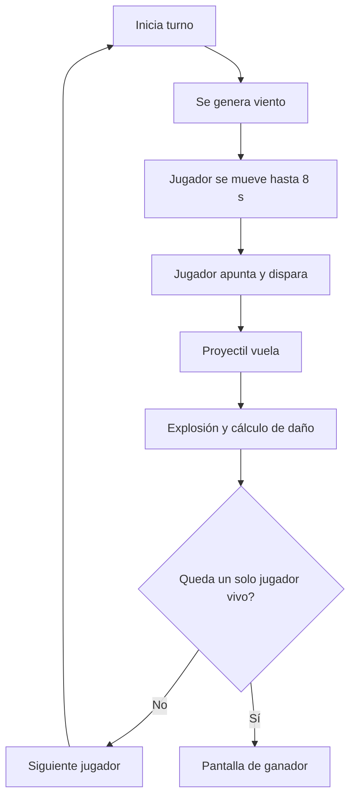

# Diseño — FrankenTillería

## Concepto
Dos jugadores ensamblan una criatura en el laboratorio de Víctor Frankenstein y luego pelean
en un campo de batalla 2D por turnos. Estética pixel art gótica y colorida: cielo de tormenta,
castillo al fondo con parallax, paleta morada, verde y amarillo eléctrico.

## Flujo
Boot -> Lab (jugador 1, jugador 2) -> Battle -> pantalla de ganador -> volver al Lab.

## Estadísticas
Base: `hp 100`, `mobility 100`, `resistance 0`, `damage 1.0`.
Cada parte tiene `mods` que se suman a la base.

| Stat | Efecto | Límite |
|---|---|---|
| hp | Vida máxima | mínimo 1 |
| mobility | Velocidad de movimiento (px/s = mobility * 1.2) | mínimo 40 |
| resistance | Reducción de daño recibido | máximo 0.6 |
| damage | Multiplicador del daño del arma | mínimo 0.5 |

El arma sale de la parte `arms`. Las demás partes solo modifican stats.

## Combate
- Orden de turnos alternado. En su turno el jugador tiene 8 s para moverse y una sola acción de ataque.
- Ataque: ángulo (mouse o flechas) + potencia (mantener espacio). El proyectil sigue una parábola con gravedad y viento.
- Viento: valor entre -10 y 10, cambia en cada turno, se muestra en el HUD.
- Daño: `weapon.damage * attacker.damage * falloff * (1 - target.resistance)`.
  `falloff` baja de 1 a 0 linealmente desde el centro de la explosión hasta su radio.
- Cuando un jugador llega a 0 de vida, el otro gana.
- Duración objetivo de una partida: 3 a 6 minutos.

## Terreno
Fase 1: terreno fijo guardado como bitmask (canvas offscreen, pixel opaco = sólido).
Fase 2 (si hay tiempo): destruir un círculo del bitmask en cada explosión.

## Armas iniciales
Cañón (parábola directa), Granada (rebota 2 veces), Rayo (casi recto, ignora viento). Ver `data/weapons.json`.

## Módulos de `core`
- `stats.js`: `computeStats(parts)`
- `damage.js`: `calcDamage({ weapon, attackerStats, targetStats, distance })`
- `turns.js`: `TurnManager` (turno actual, avanzar, vivos, ganador)
- `wind.js`: `nextWind(rng)`

## Diagrama de flujo del turno

## Fuera de alcance (solo si sobra tiempo)
Terreno destructible, más de 2 jugadores, habilidades especiales por parte, sonido dinámico.
