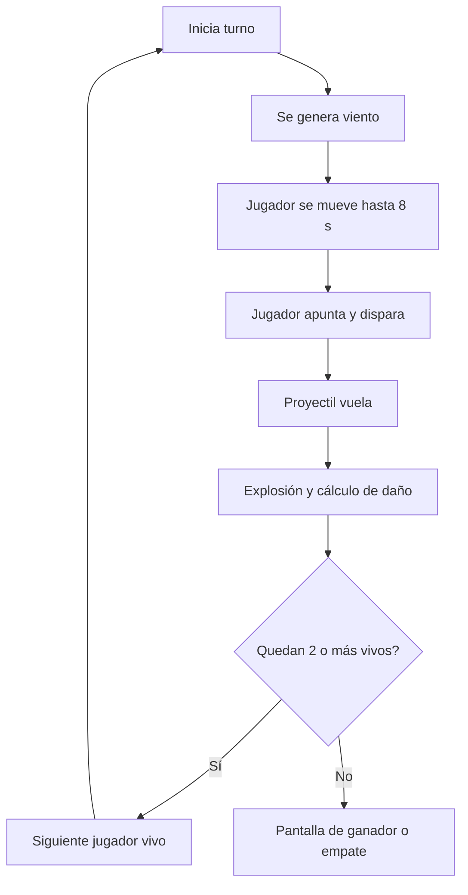

# Diseño — FrankenTillería

## Concepto
Dos jugadores ensamblan una criatura en el laboratorio de Víctor Frankenstein y luego pelean
en un campo de batalla 2D por turnos. Estética pixel art gótica y colorida: cielo de tormenta,
castillo al fondo con parallax, paleta morada, verde y amarillo eléctrico.

## Flujo de pantallas
Boot -> Controles -> Lab (jugador 1, jugador 2) -> Battle -> Ganador -> volver al Lab.

La pantalla de controles explica cómo jugar (mover, apuntar, potencia, disparar, turnos). Es
importante porque los compañeros evalúan si entendieron el juego sin ayuda.

## Contrato Lab -> Battle
El Lab inicia el combate con:

```js
this.scene.start('Battle', {
  players: [
    { name: 'Jugador 1', partIds: { head: 'head_eye', torso: 'torso_tesla', arms: 'arms_cannon', legs: 'legs_iron' } },
    { name: 'Jugador 2', partIds: { head: '...', torso: '...', arms: '...', legs: '...' } }
  ]
});
```

Battle convierte cada jugador con `buildCreature(partIds, partsData, weaponsData)` (core), que
devuelve `{ stats, weapon, parts }`. No se pasan stats ni sprites entre escenas: solo ids.
`buildCreature` lanza error si falta un slot, si un id no existe, si el id es de otro slot o si
el arma no existe.

## Estadísticas
Base: `hp 100`, `mobility 100`, `resistance 0`, `damage 1.0`. Cada parte suma sus `mods` a la base.
El resultado se redondea a 2 decimales para evitar errores de punto flotante.

| Stat | Efecto | Límite |
|---|---|---|
| hp | Vida máxima | mínimo 1 |
| mobility | Velocidad: `mobility * 0.5` px/s | mínimo 40 |
| resistance | Reducción del daño recibido | máximo 0.6 |
| damage | Multiplicador del daño del arma | mínimo 0.5 |

Con 100 de movilidad y 8 segundos, una criatura recorre unos 400 px de un mapa de 1280 px.
El arma sale de la parte `arms`. Las demás partes solo modifican stats.

## Balance
Toda parte con bonos tiene al menos una penalización (lo verifica `tests/data.test.js`).
`npm run balance` calcula las 81 combinaciones y marca como REVIEW las partes que se alejan
más de 15% del promedio. Meta: ninguna combinación gana siempre.

## Combate
- Orden alternado. En su turno el jugador tiene 8 s para moverse y una sola acción de ataque.
- Ataque: ángulo (mouse o flechas) + potencia (mantener espacio). El proyectil sigue una parábola con gravedad y viento.
- Viento: valor entre -10 y 10, cambia en cada turno, se muestra en el HUD.
- Daño: `weapon.damage * attacker.damage * falloff * (1 - target.resistance)`.
  `falloff` baja linealmente de 1 en el centro a 0 en el radio de la explosión.
- La interfaz muestra siempre la vida de cada criatura y de quién es el turno.
- Duración objetivo de una partida: 3 a 6 minutos.

### Casos límite (decisiones tomadas)
| Caso | Decisión |
|---|---|
| El jugador se daña a sí mismo con su explosión | Sí recibe daño, igual que el rival |
| Ambos llegan a 0 en la misma explosión | Empate; `TurnManager` devuelve `winner = null` y `isDraw = true` |
| Cae fuera del mapa o al agua | Muere al instante |
| Se acaban los 8 s de movimiento | Pasa a la fase de ataque; si no dispara en 15 s, pierde el turno |
| Jugador sin vida | `TurnManager` lo salta; si queda uno vivo, gana |

## Terreno
Fase 1: terreno fijo guardado como bitmask (canvas offscreen, pixel opaco = sólido).
Fase 2 (si hay tiempo): destruir un círculo del bitmask en cada explosión.

## Armas iniciales
Cañón (parábola directa), Granada (rebota 2 veces), Rayo (casi recto, ignora viento). Ver `data/weapons.json`.

## Módulos de `core`
- `stats.js`: `computeStats(parts)`
- `creature.js`: `buildCreature(partIds, partsData, weaponsData)`
- `damage.js`: `calcDamage({ weapon, attackerStats, targetStats, distance })`
- `turns.js`: `TurnManager` (turno actual, avanzar, vivos, ganador, empate)
- `wind.js`: `nextWind(rng)`

## Diagrama del turno


## Fuera de alcance (solo si sobra tiempo)
Terreno destructible, más de 2 jugadores, habilidades especiales por parte, sonido dinámico.
